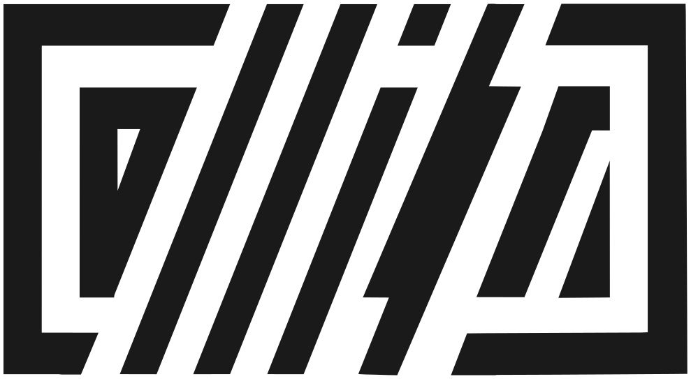

<div align="center">
  <picture>
    <source media="(prefers-color-scheme: dark)" srcset="public/assets/logo-callisto-white.svg" />
    
  </picture>

  <p align="center">
    
    
    
    
    
  </p>

  <p align="center">
    <a href="https://www.behance.net/CallistoArtwork"></a>
    <a href="https://demozoo.org/sceners/57855/"></a>
    <a href="https://www.linkedin.com/in/frederique-charton"></a>
  </p>

  <p align="center">
    <i>Portfolio & site vitrine statique de Frédérique Charton (CALLISTO) — graphisme digital, demoscene, vidéo, outils créatifs et IA.</i><br>
    Site <a href="https://callistoarts.com">callistoarts.com</a> · Dépôt <a href="https://github.com/GamePartsOnline/Portfolio-Callisto">GamePartsOnline/Portfolio-Callisto</a>
  </p>
</div>

---

## Aperçu technique

- **Framework :** **Astro 7** (génération statique SSG — `output: "static"`, `build.format: "file"` dans [`astro.config.mjs`](astro.config.mjs)).
- **Architecture UI :** **Atomic Design** sous `src/components/` (`atoms`, `molecules`, `organisms`) et layout partagé dans [`src/layouts/BaseLayout.astro`](src/layouts/BaseLayout.astro).
- **Langages & styles :** **TypeScript** en mode strict (`astro/tsconfigs/strict`, scripts sous `src/scripts/`) et **CSS modulaire** (`src/styles/` — tokens, thème Liquid Glass, scrollbar custom).
- **Données & médias :** fichiers statiques servis depuis `public/` (`public/content.json`, `public/i18n.json`, `public/assets/images/portfolio_images.json`, images WebP, démos WebM, audio).
- **Gestionnaire de paquets & qualité :** **pnpm** (`10.18.0`) et **Husky** (`pre-commit` + `pre-push`).
- **Déploiement :** **GitHub Actions** ([`.github/workflows/deploy.yml`](.github/workflows/deploy.yml)) → build pnpm + déploiement de `./dist` sur **GitHub Pages** (`public/CNAME` → `callistoarts.com`).

---

## Lancer en local

### Prérequis
- **Node.js 22+**
- **pnpm 10.18+** (via `corepack enable` ou installation pnpm)

### Installation & développement

```bash
pnpm install
pnpm run dev
```

### Commandes disponibles

| Commande | Action |
|----------|--------|
| `pnpm run dev` | Lance le serveur de développement Astro (`astro dev`) |
| `pnpm run check` | Vérifie les types TypeScript et composants Astro (`astro check`) |
| `pnpm run build` | Exécute `astro check && astro build` et génère le site statique dans `dist/` |
| `pnpm run preview` | Prévisualise le build de production Astro (`astro preview`) |
| `./start-server.sh` | Lance un serveur Python local sur `dist/` (`http://127.0.0.1:8765`, build auto si absent) |

---

## Qualité, hooks Git & CI/CD

- **Pre-commit ([`.husky/pre-commit`](.husky/pre-commit)) :**
  - bloque les fichiers sensibles (`.env*`, clés privées, motifs de tokens/secrets dans le diff) ;
  - empêche l'ajout de médias dans `assets/` au lieu de `public/assets/` ;
  - valide la syntaxe de tous les `.json` stagés ;
  - lance `pnpm run check` dès que `src/`, `astro.config.mjs`, `package.json` ou `tsconfig.json` sont modifiés.
- **Pre-push ([`.husky/pre-push`](.husky/pre-push)) :** exécute `pnpm run build` (`astro check && astro build`) avant tout `git push`.
- **Déploiement ([`.github/workflows/deploy.yml`](.github/workflows/deploy.yml)) :** chaque `push` sur `main` (ou déclenchement manuel) exécute `pnpm install --frozen-lockfile`, `pnpm run build`, puis publie `./dist` sur GitHub Pages.
- **Sécurité :** politique de divulgation publiée sur `/.well-known/security.txt` ([`public/.well-known/security.txt`](public/.well-known/security.txt)) et référentiel documenté dans [`docs/SECURITY.md`](docs/SECURITY.md).

---

## Structure du dépôt

```
├── .github/workflows/deploy.yml   # Pipeline CI/CD GitHub Pages (Node 22 + pnpm)
├── .husky/                        # Hooks Git pre-commit & pre-push
├── astro.config.mjs               # Configuration Astro (SSG static, format file)
├── package.json & pnpm-lock.yaml  # Dépendances (Astro 7, TypeScript, Husky)
├── tsconfig.json                  # Configuration TypeScript strict
├── src/
│   ├── layouts/                   # Layout principal (BaseLayout.astro)
│   ├── pages/                     # 6 pages statiques (index, portfolio, services, build-log, mentions-legales, 404)
│   ├── components/
│   │   ├── atoms/                 # Composants élémentaires (SectionTitle, SkipLink, SocialIcon)
│   │   ├── molecules/             # Composants composés (LangSwitch, TimelineItem, AboutToolsMarquee)
│   │   └── organisms/             # Sections & widgets (Hero, Header, Footer, Portfolio, Lightbox, MusicPlayer, CookieBanner…)
│   ├── scripts/                   # Logique TypeScript modulaire (carousel, filtres, grille, i18n, lightbox, audio…)
│   └── styles/                    # Feuilles CSS modulaires (tokens, glass, scrollbar, sections, a11y…)
├── public/
│   ├── .well-known/security.txt   # Contact sécurité (RFC 9116)
│   ├── CNAME                      # Domaine personnalisé callistoarts.com
│   ├── content.json & i18n.json   # Contenus & traductions FR/EN
│   ├── robots.txt, sitemap.xml, llms.txt
│   └── assets/                    # Images WebP/SVG, icônes, musiques, démos WebM
├── docs/                          # Documentation du projet (index : docs/INDEX.md)
└── scripts/                       # Utilitaires Python / shell (vignettes WebP, WebM, index Markdown…)
```

---

## Documentation & maintenance

| Besoin | Document |
|--------|----------|
| Sommaire général de la doc | [`docs/INDEX.md`](docs/INDEX.md) |
| Ajouter ou modifier une œuvre | [`docs/GUIDE.md`](docs/GUIDE.md) |
| Démos vidéo WebM vs YouTube | [`docs/MEDIA_WEBM.md`](docs/MEDIA_WEBM.md) |
| Design system Liquid Glass & UI | [`docs/DESIGN.md`](docs/DESIGN.md) |
| Internationalisation FR/EN | [`docs/I18N.md`](docs/I18N.md) |
| Accessibilité (a11y) | [`docs/A11Y.md`](docs/A11Y.md) |
| Sécurité & bonnes pratiques | [`docs/SECURITY.md`](docs/SECURITY.md) |
| Hébergement DNS / TLS & déploiement | [`docs/HOSTING.md`](docs/HOSTING.md) · [`docs/DEPLOY.md`](docs/DEPLOY.md) |

---

## Fonctionnalités principales (v3)

- **Multi-pages statiques SEO-friendly :** Accueil (`/`), Portfolio (`/portfolio.html`), Services (`/services.html`), Build Log (`/build-log.html`), Mentions légales (`/mentions-legales.html`) et `404.html`.
- **Hero & galerie synchronisés :** carousel d'ouverture et grille portfolio alimentés par `portfolio_images.json`, filtres par catégorie (filtre initial allégé) et lightbox (image, vidéo WebM locale ou embed YouTube selon consentement).
- **Expérience & UI :** lecteur audio intégré (`MusicPlayer`), mode « Nuit d'atelier », timeline « Journey », barre de défilement custom Liquid Glass, traduction dynamique FR/EN, consentement cookies et accessibilité clavier / ARIA / `prefers-reduced-motion`.

---

## Licence

© 2026 CALLISTO — Frédérique Charton. Tous droits réservés sur les œuvres et le site.

---

*My fun is DRAWING. ALWAYS. And forever.*
